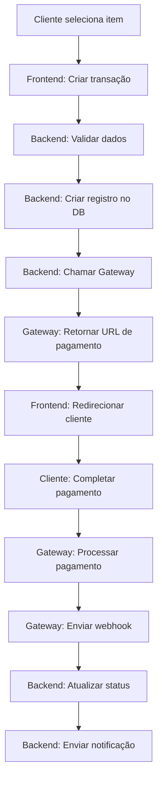

# 💳 Guia Completo: Como Implementar um GPO (Gateway de Pagamento Online)

## 📋 Índice

1. [O que é um GPO?](#o-que-é-um-gpo)
2. [Arquitetura de um Sistema de Pagamento](#arquitetura-de-um-sistema-de-pagamento)
3. [Fluxo Completo de Pagamento](#fluxo-completo-de-pagamento)
4. [Estrutura de Dados](#estrutura-de-dados)
5. [Implementação Backend](#implementação-backend)
6. [Implementação Frontend](#implementação-frontend)
7. [Integração com Gateways Externos](#integração-com-gateways-externos)
8. [Webhooks e Confirmações](#webhooks-e-confirmações)
9. [Segurança e Boas Práticas](#segurança-e-boas-práticas)
10. [Exemplos Práticos](#exemplos-práticos)

---

## 🎯 O que é um GPO?

Um **Gateway de Pagamento Online (GPO)** é um sistema que processa transações de pagamento entre clientes e comerciantes. Ele atua como intermediário, garantindo que os pagamentos sejam processados de forma segura e confiável.

### Componentes Principais

- **Frontend**: Interface onde o usuário inicia o pagamento
- **Backend API**: Processa e gerencia transações
- **Gateway de Pagamento**: Provedor externo (Stripe, PayPal, etc.)
- **Banco de Dados**: Armazena transações e histórico
- **Sistema de Notificações**: Envia confirmações por email/SMS

---

## 🏗️ Arquitetura de um Sistema de Pagamento

```
┌─────────────────────────────────────────────────────────────┐
│                    ARQUITETURA DO GPO                        │
└─────────────────────────────────────────────────────────────┘

┌──────────────┐     ┌──────────────┐     ┌──────────────┐
│   Frontend   │────▶│  Backend API │────▶│   Database   │
│  (Cliente)   │     │  (GPO)       │     │  (Transações)│
└──────────────┘     └──────────────┘     └──────────────┘
                            │
                            │
                            ▼
                    ┌──────────────┐
                    │   Gateway    │
                    │  (Stripe/    │
                    │   PayPal)    │
                    └──────────────┘
                            │
                            │ (Webhook)
                            ▼
                    ┌──────────────┐
                    │  Notificação │
                    │  (Email/SMS) │
                    └──────────────┘
```

### Fluxo de Comunicação

1. **Cliente** → **Frontend**: Seleciona item para pagar
2. **Frontend** → **Backend API**: Cria transação
3. **Backend API** → **Gateway**: Inicia pagamento
4. **Gateway** → **Cliente**: Redireciona para checkout
5. **Cliente** → **Gateway**: Completa pagamento
6. **Gateway** → **Backend API**: Webhook de confirmação
7. **Backend API** → **Database**: Atualiza status
8. **Backend API** → **Cliente**: Notificação de sucesso

---

## 🔄 Fluxo Completo de Pagamento

### 1. Criação da Transação



### 2. Processamento do Pagamento

**Passo 1: Cliente inicia pagamento**

```typescript
// Frontend
const handlePayment = async (itemId: string, amount: number) => {
    // Criar transação no backend
    const response = await fetch('/api/payments/create', {
        method: 'POST',
        headers: {
            'Content-Type': 'application/json',
            'Authorization': `Bearer ${token}`,
        },
        body: JSON.stringify({
            item_id: itemId,
            amount: amount,
            payment_method: 'card', // ou 'qr_code', 'reference', etc.
        }),
    });
    
    const { transaction } = await response.json();
    
    // Redirecionar para URL de pagamento
    window.location.href = transaction.payment_url;
};
```

**Passo 2: Backend cria transação**

```php
// Backend - PaymentController.php

public function create(Request $request)
{
    // 1. Validar dados
    $validated = $request->validate([
        'item_id' => 'required|uuid',
        'amount' => 'required|numeric|min:0.01',
        'payment_method' => 'required|in:card,qr_code,reference,bank_transfer',
    ]);
    
    // 2. Criar transação no banco
    $transaction = Transaction::create([
        'id' => Str::uuid(),
        'user_id' => $request->user()->id,
        'item_id' => $validated['item_id'],
        'amount' => $validated['amount'],
        'payment_method' => $validated['payment_method'],
        'status' => 'pending',
        'expires_at' => now()->addHours(24), // Válido por 24 horas
    ]);
    
    // 3. Integrar com gateway
    $gatewayResponse = $this->paymentGateway->createPayment([
        'transaction_id' => $transaction->id,
        'amount' => $transaction->amount,
        'currency' => 'AOA',
        'payment_method' => $transaction->payment_method,
        'return_url' => config('app.url') . '/payment/success',
        'cancel_url' => config('app.url') . '/payment/cancel',
    ]);
    
    // 4. Atualizar transação com URL de pagamento
    $transaction->update([
        'payment_url' => $gatewayResponse['payment_url'],
        'gateway_transaction_id' => $gatewayResponse['gateway_id'],
    ]);
    
    return response()->json([
        'status' => 'success',
        'transaction' => $transaction,
    ]);
}
```

**Passo 3: Cliente completa pagamento no gateway**

O cliente é redirecionado para o gateway (Stripe, PayPal, etc.) onde:
- Insere dados do cartão
- Confirma o pagamento
- É redirecionado de volta para a aplicação

**Passo 4: Gateway envia webhook**

```php
// Backend - WebhookController.php

public function handle(Request $request)
{
    // 1. Verificar assinatura do webhook (segurança)
    if (!$this->verifyWebhookSignature($request)) {
        return response()->json(['error' => 'Invalid signature'], 401);
    }
    
    // 2. Buscar transação
    $transaction = Transaction::where('gateway_transaction_id', $request->gateway_id)
        ->firstOrFail();
    
    // 3. Atualizar status baseado na resposta do gateway
    $status = $this->mapGatewayStatus($request->status);
    
    $transaction->update([
        'status' => $status,
        'paid_at' => $request->status === 'paid' ? now() : null,
        'gateway_response' => $request->all(),
    ]);
    
    // 4. Atualizar item relacionado (ex: propina, produto, etc.)
    if ($status === 'paid') {
        $this->markItemAsPaid($transaction->item_id);
    }
    
    // 5. Enviar notificação
    if ($status === 'paid') {
        $this->sendPaymentNotification($transaction);
    }
    
    return response()->json(['status' => 'ok']);
}

private function verifyWebhookSignature(Request $request): bool
{
    $signature = $request->header('X-Gateway-Signature');
    $payload = $request->getContent();
    $secret = config('services.gateway.webhook_secret');
    
    $expectedSignature = hash_hmac('sha256', $payload, $secret);
    
    return hash_equals($expectedSignature, $signature);
}
```

---

## 📊 Estrutura de Dados

### Tabela: `transactions`

```sql
CREATE TABLE transactions (
    id UUID PRIMARY KEY,
    user_id UUID NOT NULL,
    item_id UUID NOT NULL, -- ID do item sendo pago (propina, produto, etc.)
    item_type VARCHAR(50) NOT NULL, -- 'fee', 'product', 'service', etc.
    amount DECIMAL(10, 2) NOT NULL,
    currency VARCHAR(3) DEFAULT 'AOA',
    payment_method VARCHAR(50) NOT NULL, -- 'card', 'qr_code', 'reference', etc.
    status VARCHAR(20) DEFAULT 'pending', -- 'pending', 'processing', 'paid', 'failed', 'cancelled'
    
    -- Dados do gateway
    gateway_transaction_id VARCHAR(255) NULL,
    gateway_name VARCHAR(50) NULL, -- 'stripe', 'paypal', etc.
    payment_url TEXT NULL,
    
    -- Metadados
    metadata JSON NULL, -- Dados adicionais (QR code, referência, etc.)
    gateway_response JSON NULL, -- Resposta completa do gateway
    
    -- Timestamps
    expires_at TIMESTAMP NULL,
    paid_at TIMESTAMP NULL,
    created_at TIMESTAMP DEFAULT CURRENT_TIMESTAMP,
    updated_at TIMESTAMP DEFAULT CURRENT_TIMESTAMP ON UPDATE CURRENT_TIMESTAMP,
    
    -- Índices
    INDEX idx_user_id (user_id),
    INDEX idx_item_id (item_id),
    INDEX idx_status (status),
    INDEX idx_gateway_transaction_id (gateway_transaction_id),
    INDEX idx_created_at (created_at)
);
```

### Modelo: `Transaction`

```php
// app/Models/Transaction.php

class Transaction extends Model
{
    const STATUS_PENDING = 'pending';
    const STATUS_PROCESSING = 'processing';
    const STATUS_PAID = 'paid';
    const STATUS_FAILED = 'failed';
    const STATUS_CANCELLED = 'cancelled';
    
    const PAYMENT_METHOD_CARD = 'card';
    const PAYMENT_METHOD_QR_CODE = 'qr_code';
    const PAYMENT_METHOD_REFERENCE = 'reference';
    const PAYMENT_METHOD_BANK_TRANSFER = 'bank_transfer';
    
    protected $fillable = [
        'id',
        'user_id',
        'item_id',
        'item_type',
        'amount',
        'currency',
        'payment_method',
        'status',
        'gateway_transaction_id',
        'gateway_name',
        'payment_url',
        'metadata',
        'gateway_response',
        'expires_at',
        'paid_at',
    ];
    
    protected $casts = [
        'amount' => 'decimal:2',
        'metadata' => 'array',
        'gateway_response' => 'array',
        'expires_at' => 'datetime',
        'paid_at' => 'datetime',
    ];
    
    public function user()
    {
        return $this->belongsTo(User::class);
    }
    
    public function isPending(): bool
    {
        return $this->status === self::STATUS_PENDING;
    }
    
    public function isPaid(): bool
    {
        return $this->status === self::STATUS_PAID;
    }
    
    public function isExpired(): bool
    {
        return $this->expires_at && $this->expires_at->isPast();
    }
}
```

---

## ⚙️ Implementação Backend

### 1. Service de Gateway de Pagamento

```php
// app/Services/PaymentGatewayService.php

class PaymentGatewayService
{
    private $gateway;
    
    public function __construct()
    {
        // Inicializar gateway baseado na configuração
        $gatewayName = config('services.payment.gateway'); // 'stripe', 'paypal', etc.
        
        switch ($gatewayName) {
            case 'stripe':
                $this->gateway = new StripeGateway();
                break;
            case 'paypal':
                $this->gateway = new PayPalGateway();
                break;
            default:
                throw new \Exception("Gateway não configurado");
        }
    }
    
    public function createPayment(array $data): array
    {
        // Preparar dados para o gateway
        $paymentData = [
            'amount' => $data['amount'] * 100, // Converter para centavos
            'currency' => strtolower($data['currency'] ?? 'aoa'),
            'metadata' => [
                'transaction_id' => $data['transaction_id'],
                'user_id' => $data['user_id'],
            ],
            'return_url' => $data['return_url'],
            'cancel_url' => $data['cancel_url'],
        ];
        
        // Chamar gateway
        $response = $this->gateway->createPayment($paymentData);
        
        return [
            'payment_url' => $response['url'],
            'gateway_id' => $response['id'],
        ];
    }
    
    public function verifyWebhook(array $payload, string $signature): bool
    {
        return $this->gateway->verifyWebhook($payload, $signature);
    }
    
    public function getPaymentStatus(string $gatewayId): array
    {
        return $this->gateway->getPaymentStatus($gatewayId);
    }
}
```

### 2. Gateway Abstrato

```php
// app/Services/Gateways/GatewayInterface.php

interface GatewayInterface
{
    public function createPayment(array $data): array;
    public function verifyWebhook(array $payload, string $signature): bool;
    public function getPaymentStatus(string $gatewayId): array;
}
```

### 3. Implementação Stripe

```php
// app/Services/Gateways/StripeGateway.php

use Stripe\Stripe;
use Stripe\Checkout\Session;

class StripeGateway implements GatewayInterface
{
    public function __construct()
    {
        Stripe::setApiKey(config('services.stripe.secret_key'));
    }
    
    public function createPayment(array $data): array
    {
        $session = Session::create([
            'payment_method_types' => ['card'],
            'line_items' => [[
                'price_data' => [
                    'currency' => $data['currency'],
                    'product_data' => [
                        'name' => 'Pagamento',
                    ],
                    'unit_amount' => $data['amount'],
                ],
                'quantity' => 1,
            ]],
            'mode' => 'payment',
            'success_url' => $data['return_url'] . '?session_id={CHECKOUT_SESSION_ID}',
            'cancel_url' => $data['cancel_url'],
            'metadata' => $data['metadata'],
        ]);
        
        return [
            'id' => $session->id,
            'url' => $session->url,
        ];
    }
    
    public function verifyWebhook(array $payload, string $signature): bool
    {
        try {
            $event = \Stripe\Webhook::constructEvent(
                json_encode($payload),
                $signature,
                config('services.stripe.webhook_secret')
            );
            return true;
        } catch (\Exception $e) {
            return false;
        }
    }
    
    public function getPaymentStatus(string $gatewayId): array
    {
        $session = Session::retrieve($gatewayId);
        
        return [
            'status' => $session->payment_status === 'paid' ? 'paid' : 'pending',
            'paid_at' => $session->payment_status === 'paid' ? now() : null,
        ];
    }
}
```

### 4. Controller de Pagamentos

```php
// app/Http/Controllers/PaymentController.php

class PaymentController extends Controller
{
    private $paymentGateway;
    
    public function __construct(PaymentGatewayService $paymentGateway)
    {
        $this->paymentGateway = $paymentGateway;
    }
    
    public function create(Request $request)
    {
        $validated = $request->validate([
            'item_id' => 'required|uuid',
            'item_type' => 'required|string',
            'amount' => 'required|numeric|min:0.01',
            'payment_method' => 'required|string',
        ]);
        
        $transaction = Transaction::create([
            'id' => Str::uuid(),
            'user_id' => $request->user()->id,
            'item_id' => $validated['item_id'],
            'item_type' => $validated['item_type'],
            'amount' => $validated['amount'],
            'payment_method' => $validated['payment_method'],
            'status' => Transaction::STATUS_PENDING,
            'expires_at' => now()->addHours(24),
        ]);
        
        $gatewayResponse = $this->paymentGateway->createPayment([
            'transaction_id' => $transaction->id,
            'user_id' => $transaction->user_id,
            'amount' => $transaction->amount,
            'currency' => 'AOA',
            'return_url' => config('app.url') . '/payment/success',
            'cancel_url' => config('app.url') . '/payment/cancel',
        ]);
        
        $transaction->update([
            'payment_url' => $gatewayResponse['payment_url'],
            'gateway_transaction_id' => $gatewayResponse['gateway_id'],
            'gateway_name' => config('services.payment.gateway'),
        ]);
        
        return response()->json([
            'status' => 'success',
            'transaction' => $transaction,
        ]);
    }
    
    public function getStatus(Request $request, string $transactionId)
    {
        $transaction = Transaction::where('id', $transactionId)
            ->where('user_id', $request->user()->id)
            ->firstOrFail();
        
        return response()->json([
            'status' => 'success',
            'transaction' => $transaction,
        ]);
    }
}
```

### 5. Controller de Webhooks

```php
// app/Http/Controllers/WebhookController.php

class WebhookController extends Controller
{
    private $paymentGateway;
    
    public function __construct(PaymentGatewayService $paymentGateway)
    {
        $this->paymentGateway = $paymentGateway;
    }
    
    public function handle(Request $request)
    {
        $signature = $request->header('X-Gateway-Signature');
        
        if (!$this->paymentGateway->verifyWebhook($request->all(), $signature)) {
            return response()->json(['error' => 'Invalid signature'], 401);
        }
        
        $gatewayId = $request->input('gateway_transaction_id');
        $transaction = Transaction::where('gateway_transaction_id', $gatewayId)
            ->firstOrFail();
        
        $status = $this->mapStatus($request->input('status'));
        
        $transaction->update([
            'status' => $status,
            'paid_at' => $status === Transaction::STATUS_PAID ? now() : null,
            'gateway_response' => $request->all(),
        ]);
        
        if ($status === Transaction::STATUS_PAID) {
            $this->handleSuccessfulPayment($transaction);
        }
        
        return response()->json(['status' => 'ok']);
    }
    
    private function mapStatus(string $gatewayStatus): string
    {
        $mapping = [
            'succeeded' => Transaction::STATUS_PAID,
            'paid' => Transaction::STATUS_PAID,
            'pending' => Transaction::STATUS_PROCESSING,
            'failed' => Transaction::STATUS_FAILED,
            'cancelled' => Transaction::STATUS_CANCELLED,
        ];
        
        return $mapping[$gatewayStatus] ?? Transaction::STATUS_PENDING;
    }
    
    private function handleSuccessfulPayment(Transaction $transaction)
    {
        // Atualizar item como pago
        $this->updateItemStatus($transaction);
        
        // Enviar notificação
        $this->sendNotification($transaction);
    }
    
    private function updateItemStatus(Transaction $transaction)
    {
        switch ($transaction->item_type) {
            case 'fee':
                Fee::where('id', $transaction->item_id)
                    ->update(['status' => 'paid']);
                break;
            // Adicionar outros tipos conforme necessário
        }
    }
    
    private function sendNotification(Transaction $transaction)
    {
        // Enviar email/SMS de confirmação
        // Implementar conforme necessário
    }
}
```

---

## 🎨 Implementação Frontend

### 1. Service de Pagamento

```typescript
// services/paymentService.ts

class PaymentService {
    private baseURL = process.env.NEXT_PUBLIC_API_URL;
    
    async createTransaction(data: {
        item_id: string;
        item_type: string;
        amount: number;
        payment_method: string;
    }): Promise<Transaction> {
        const response = await fetch(`${this.baseURL}/api/payments/create`, {
            method: 'POST',
            headers: {
                'Content-Type': 'application/json',
                'Authorization': `Bearer ${this.getToken()}`,
            },
            body: JSON.stringify(data),
        });
        
        const result = await response.json();
        
        if (result.status === 'success') {
            return result.transaction;
        }
        
        throw new Error(result.message || 'Erro ao criar transação');
    }
    
    async getTransactionStatus(transactionId: string): Promise<Transaction> {
        const response = await fetch(
            `${this.baseURL}/api/payments/${transactionId}/status`,
            {
                headers: {
                    'Authorization': `Bearer ${this.getToken()}`,
                },
            }
        );
        
        const result = await response.json();
        return result.transaction;
    }
    
    private getToken(): string {
        return localStorage.getItem('auth_token') || '';
    }
}

export const paymentService = new PaymentService();
```

### 2. Componente de Pagamento

```typescript
// components/PaymentButton.tsx

import { useState } from 'react';
import { paymentService } from '@/services/paymentService';

interface PaymentButtonProps {
    itemId: string;
    itemType: string;
    amount: number;
    paymentMethod: 'card' | 'qr_code' | 'reference';
}

export default function PaymentButton({
    itemId,
    itemType,
    amount,
    paymentMethod,
}: PaymentButtonProps) {
    const [loading, setLoading] = useState(false);
    
    const handlePayment = async () => {
        setLoading(true);
        
        try {
            const transaction = await paymentService.createTransaction({
                item_id: itemId,
                item_type: itemType,
                amount: amount,
                payment_method: paymentMethod,
            });
            
            // Redirecionar para URL de pagamento
            window.location.href = transaction.payment_url;
        } catch (error) {
            console.error('Erro ao processar pagamento:', error);
            alert('Erro ao processar pagamento. Tente novamente.');
        } finally {
            setLoading(false);
        }
    };
    
    return (
        <button
            onClick={handlePayment}
            disabled={loading}
            className="payment-button"
        >
            {loading ? 'Processando...' : 'Pagar'}
        </button>
    );
}
```

### 3. Página de Sucesso

```typescript
// pages/payment/success.tsx

import { useEffect, useState } from 'react';
import { useRouter } from 'next/router';
import { paymentService } from '@/services/paymentService';

export default function PaymentSuccess() {
    const router = useRouter();
    const { session_id, transaction_id } = router.query;
    const [status, setStatus] = useState<'loading' | 'success' | 'error'>('loading');
    
    useEffect(() => {
        const checkPayment = async () => {
            if (transaction_id) {
                try {
                    const transaction = await paymentService.getTransactionStatus(
                        transaction_id as string
                    );
                    
                    if (transaction.status === 'paid') {
                        setStatus('success');
                    } else {
                        setStatus('error');
                    }
                } catch (error) {
                    setStatus('error');
                }
            }
        };
        
        checkPayment();
    }, [transaction_id]);
    
    if (status === 'loading') {
        return <div>Verificando pagamento...</div>;
    }
    
    if (status === 'success') {
        return (
            <div>
                <h1>Pagamento Confirmado!</h1>
                <p>Seu pagamento foi processado com sucesso.</p>
            </div>
        );
    }
    
    return (
        <div>
            <h1>Erro no Pagamento</h1>
            <p>Ocorreu um erro ao processar seu pagamento.</p>
        </div>
    );
}
```

### 4. Polling de Status (Alternativa)

```typescript
// hooks/usePaymentStatus.ts

import { useEffect, useState } from 'react';
import { paymentService } from '@/services/paymentService';

export function usePaymentStatus(transactionId: string | null) {
    const [status, setStatus] = useState<string | null>(null);
    const [loading, setLoading] = useState(true);
    
    useEffect(() => {
        if (!transactionId) return;
        
        const checkStatus = async () => {
            try {
                const transaction = await paymentService.getTransactionStatus(transactionId);
                setStatus(transaction.status);
                
                // Se ainda está pendente, continuar verificando
                if (transaction.status === 'pending' || transaction.status === 'processing') {
                    setTimeout(checkStatus, 5000); // Verificar a cada 5 segundos
                } else {
                    setLoading(false);
                }
            } catch (error) {
                console.error('Erro ao verificar status:', error);
                setLoading(false);
            }
        };
        
        checkStatus();
    }, [transactionId]);
    
    return { status, loading };
}
```

---

## 🔌 Integração com Gateways Externos

### Configuração

```php
// config/services.php

return [
    'payment' => [
        'gateway' => env('PAYMENT_GATEWAY', 'stripe'), // 'stripe', 'paypal', etc.
    ],
    
    'stripe' => [
        'public_key' => env('STRIPE_PUBLIC_KEY'),
        'secret_key' => env('STRIPE_SECRET_KEY'),
        'webhook_secret' => env('STRIPE_WEBHOOK_SECRET'),
    ],
    
    'paypal' => [
        'client_id' => env('PAYPAL_CLIENT_ID'),
        'client_secret' => env('PAYPAL_CLIENT_SECRET'),
        'mode' => env('PAYPAL_MODE', 'sandbox'), // 'sandbox' ou 'live'
        'webhook_id' => env('PAYPAL_WEBHOOK_ID'),
    ],
];
```

### Rotas

```php
// routes/api.php

// Rotas públicas
Route::post('/payments/webhook', [WebhookController::class, 'handle']);

// Rotas protegidas
Route::middleware('auth:api')->group(function () {
    Route::post('/payments/create', [PaymentController::class, 'create']);
    Route::get('/payments/{transactionId}/status', [PaymentController::class, 'getStatus']);
});
```

---

## 🔔 Webhooks e Confirmações

### Configuração de Webhook no Gateway

**Stripe:**
1. Acesse o dashboard do Stripe
2. Vá em Developers → Webhooks
3. Adicione endpoint: `https://seu-dominio.com/api/payments/webhook`
4. Selecione eventos: `checkout.session.completed`, `payment_intent.succeeded`
5. Copie o Webhook Secret

**PayPal:**
1. Acesse o dashboard do PayPal
2. Vá em Apps & Credentials → Webhooks
3. Adicione URL: `https://seu-dominio.com/api/payments/webhook`
4. Selecione eventos de pagamento
5. Copie o Webhook ID

### Processamento de Webhook

```php
// app/Http/Controllers/WebhookController.php

public function handle(Request $request)
{
    // Log do webhook recebido
    Log::info('Webhook recebido', [
        'headers' => $request->headers->all(),
        'body' => $request->all(),
    ]);
    
    // Verificar assinatura
    $signature = $request->header('X-Gateway-Signature');
    if (!$this->verifySignature($request, $signature)) {
        Log::warning('Webhook com assinatura inválida');
        return response()->json(['error' => 'Invalid signature'], 401);
    }
    
    // Processar evento
    $eventType = $request->input('type');
    
    switch ($eventType) {
        case 'checkout.session.completed':
        case 'payment.succeeded':
            $this->handlePaymentSuccess($request);
            break;
            
        case 'payment.failed':
            $this->handlePaymentFailure($request);
            break;
            
        default:
            Log::info('Evento não processado', ['type' => $eventType]);
    }
    
    return response()->json(['status' => 'ok']);
}
```

---

## 🔒 Segurança e Boas Práticas

### 1. Validação de Dados

```php
// Sempre validar dados de entrada
$validated = $request->validate([
    'amount' => 'required|numeric|min:0.01|max:1000000',
    'payment_method' => 'required|in:card,qr_code,reference',
]);
```

### 2. Verificação de Assinatura de Webhook

```php
private function verifySignature(Request $request, string $signature): bool
{
    $payload = $request->getContent();
    $secret = config('services.stripe.webhook_secret');
    $expectedSignature = hash_hmac('sha256', $payload, $secret);
    
    return hash_equals($expectedSignature, $signature);
}
```

### 3. Rate Limiting

```php
// routes/api.php
Route::middleware(['auth:api', 'throttle:10,1'])->group(function () {
    Route::post('/payments/create', [PaymentController::class, 'create']);
});
```

### 4. Logging

```php
// Sempre logar transações importantes
Log::info('Transação criada', [
    'transaction_id' => $transaction->id,
    'user_id' => $transaction->user_id,
    'amount' => $transaction->amount,
]);

Log::error('Erro ao processar pagamento', [
    'transaction_id' => $transaction->id,
    'error' => $e->getMessage(),
]);
```

### 5. Tratamento de Erros

```php
try {
    $gatewayResponse = $this->paymentGateway->createPayment($data);
} catch (GatewayException $e) {
    Log::error('Erro no gateway', ['error' => $e->getMessage()]);
    
    return response()->json([
        'status' => 'error',
        'message' => 'Erro ao processar pagamento. Tente novamente.',
    ], 500);
}
```

---

## 📝 Exemplos Práticos

### Exemplo 1: Pagamento de Propina

```typescript
// Frontend
const handleFeePayment = async (feeId: string, amount: number) => {
    const transaction = await paymentService.createTransaction({
        item_id: feeId,
        item_type: 'fee',
        amount: amount,
        payment_method: 'card',
    });
    
    window.location.href = transaction.payment_url;
};
```

### Exemplo 2: Pagamento por QR Code

```typescript
// Frontend - Scanner de QR Code
const handleQRScan = async (qrCodeData: string) => {
    // Extrair dados do QR Code
    const { item_id, amount } = parseQRCode(qrCodeData);
    
    const transaction = await paymentService.createTransaction({
        item_id: item_id,
        item_type: 'product',
        amount: amount,
        payment_method: 'qr_code',
        metadata: { qr_code: qrCodeData },
    });
    
    // Mostrar confirmação
    showConfirmation(transaction);
};
```

### Exemplo 3: Verificação de Status

```typescript
// Verificar status periodicamente
const checkPaymentStatus = async (transactionId: string) => {
    const transaction = await paymentService.getTransactionStatus(transactionId);
    
    if (transaction.status === 'paid') {
        // Atualizar UI
        showSuccessMessage();
        refreshItems();
    } else if (transaction.status === 'failed') {
        showErrorMessage();
    }
};
```

---

## 🚀 Checklist de Implementação

- [ ] Criar tabela `transactions` no banco de dados
- [ ] Implementar modelo `Transaction`
- [ ] Criar service de gateway de pagamento
- [ ] Implementar integração com gateway (Stripe/PayPal)
- [ ] Criar controller de pagamentos
- [ ] Criar controller de webhooks
- [ ] Implementar verificação de assinatura de webhook
- [ ] Criar rotas da API
- [ ] Implementar frontend de pagamento
- [ ] Implementar página de sucesso/erro
- [ ] Adicionar notificações (email/SMS)
- [ ] Implementar logging
- [ ] Adicionar testes
- [ ] Configurar variáveis de ambiente
- [ ] Documentar API

---

## 📚 Recursos Adicionais

- **Stripe Documentation**: https://stripe.com/docs
- **PayPal Developer**: https://developer.paypal.com
- **Laravel Documentation**: https://laravel.com/docs
- **Next.js Documentation**: https://nextjs.org/docs

---

**Última atualização:** Dezembro 2025
**Versão:** 1.0.0
